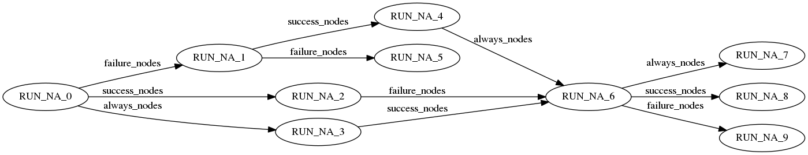
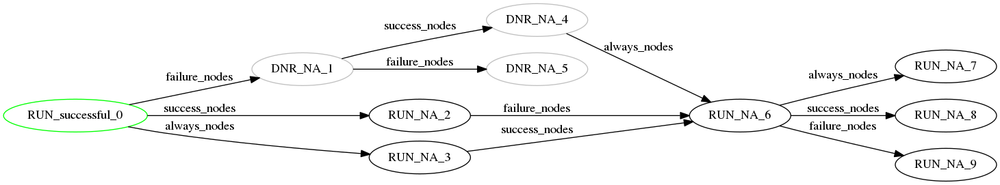
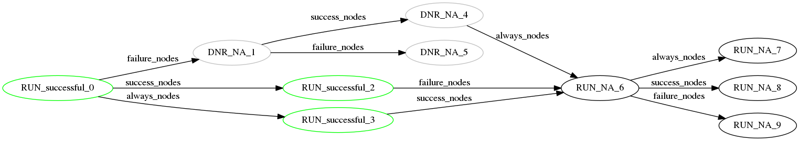
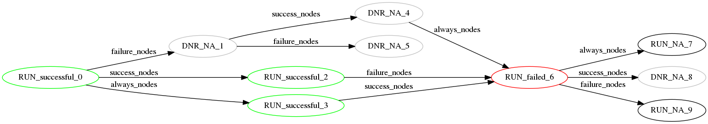
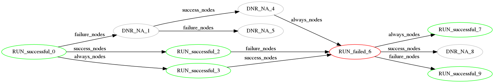

## Ascender Workflow Overview

Workflows are structured compositions of Ascender job resources. The only job of a workflow is to trigger other jobs in specific orders to achieve certain goals, such as tracking the full set of jobs that were part of a release process as a single unit.

A workflow has a graph of nodes. Each node has one template (a job template, a project, an inventory source, an approval template or another workflow job template) and may carry launch-time values (credentials, inventory, variables and so on) that are applied to the job it runs, as far as that template accepts them.

The API is in `src/internal/api`: workflow job templates and their launch and copy in `workflow_templates.go`, workflow jobs in `workflow.go`, nodes and their links in `workflow_nodes.go`, approvals in `workflow_approvals.go`, relaunch in `workflow_relaunch.go`, and the creation of a node's job in `workflow_spawn.go`. Workflow jobs are run by the workflow manager of `ascender-task` (`src/internal/tasks/workflow.go`, approvals and nested workflows in `src/internal/tasks/workflow_approvals.go`; see [Task Manager System Overview](./task_manager_system.md#workflow-manager)).


## Usage Manual

### Workflow Create-Read-Update-Delete (CRUD)

Like other job resources, workflow jobs are created from workflow job templates (`/api/v2/workflow_job_templates/`). The API exposes fields similar to job templates, including labels, schedules, notification templates (`notification_templates_started`, `_success`, `_error` and `_approvals`), extra variables and survey specifications. The template's nodes are listed and created at `related.workflow_nodes` (`/api/v2/workflow_job_templates/N/workflow_nodes/`), and the workflow jobs it launched at `/api/v2/workflow_job_templates/N/workflow_jobs/`.

### Permissions

Organization administrators have full control over the workflow job templates of their organization, and share it with the users who have the organization's `workflow_admin_role`. A workflow job template's own roles delegate the rest:

* `admin_role` lets a user change and delete the template and its nodes;
* `execute_role` lets a user launch it;
* `approval_role` lets a user approve or deny its approval nodes (see [Workflow Approval Nodes](#workflow-approval-nodes));
* `read_role` lets a user see it, its nodes, its workflow jobs and their approvals.

Adding or changing a node takes admin on the workflow job template and the right to start the node's template (execute on a job template or workflow job template, update on a project, update on an inventory source's inventory, execute on the workflow job template for an approval node), and use of a prompted inventory. A node can be deleted with admin on the workflow job template alone.

A workflow job can be seen by those who can see its template (its workflow job template, or the job template of a sliced job). The workflow job of a bulk job launch (see [Bulk API](./bulk_api.md)) has no template: it can be seen by the user who launched it and by the direct admins of its organization, and it is in the `/api/v2/workflow_jobs/` list of those admins only (the list does not show the user who launched it, nor organization auditors; the `/api/v2/unified_jobs/` list shows organization admins and auditors every job of the organization). A workflow job can be canceled by a superuser, by the user who launched it (seeing it is not needed), by an admin of its workflow job template, or by one who may delete it; canceling a job that is no longer running is refused (`403`, a `405` for a superuser). It can be deleted by a superuser or a workflow admin (`workflow_admin_role`) of its workflow job template's organization, so a sliced or bulk job only by a superuser. Relaunching it takes execute on its workflow job template, or on the job template of a sliced job; a bulk job only a superuser can relaunch (see [Workflow Copy and Relaunch](#workflow-copy-and-relaunch)). The `start` capability of a workflow job without a workflow job template is a superuser's alone. Workflow job nodes are read-only: they go away with their workflow job.


### Workflow Nodes

Workflow nodes are the containers of the jobs a workflow spawns. Workflow job template nodes (`/api/v2/workflow_job_template_nodes/`) make up the template's graph; when the template is launched, each is copied to a workflow job node (`/api/v2/workflow_job_nodes/`) of the new workflow job.

A template node is created under `/api/v2/workflow_job_templates/N/workflow_nodes/`, or under `/api/v2/workflow_job_template_nodes/` with its `workflow_job_template`. Its main fields are:

* `unified_job_template`: what the node runs. A job template runs a job, a project a project update, an inventory source an inventory update, a workflow job template a nested workflow job (see [Workflows as Workflow Nodes](#workflows-as-workflow-nodes)), an approval template an approval (see [Workflow Approval Nodes](#workflow-approval-nodes)), and a system job template (a superuser's choice) a system job. A system job template asks for nothing, so a system job spawned by a node gets neither the node's prompts nor the workflow's: it runs with the template's job type and no extra variables.
* `success_nodes`, `failure_nodes`, `always_nodes`: the children run when the node's job succeeds, when it fails, and in either case.
* `condition_nodes` and `condition_edges`: children reached through a conditional link (see [Conditional Links](#conditional-links)).
* `all_parents_must_converge`: see [Convergence](#convergence).
* `max_retries`: see [Automatic Node Retries](#automatic-node-retries).
* `identifier`: see below.
* the launch-time values: `inventory`, `execution_environment`, `scm_branch`, `job_type`, `job_tags`, `skip_tags`, `limit`, `diff_mode`, `verbosity`, `forks`, `job_slice_count`, `timeout` and `extra_data`, and the sub-lists `credentials`, `labels` and `instance_groups` (see [Workflow Launch Configuration](#workflow-launch-configuration)).

A workflow job node has the same fields, plus `job` (the job it spawned), `do_not_run` (the node was found unable to run), `retry_attempts` and `retried_jobs`, and the relaunch fields `prior_run_succeeded`, `prior_run_elapsed`, `forced_success`, `forced_success_reason`, `forced_success_by` and `forced_success_job` (see [Workflow Copy and Relaunch](#workflow-copy-and-relaunch)).

Workflow nodes also have an `identifier` field, which enables clients to do idempotent CRUD actions.
This can function the same as the `name` field for other resources, in that the client can set its value as needed.
Unlike `name`, if the client does not provide the `identifier` field, the server assigns a random UUID4 value.
It must be unique within a workflow job template (`The fields identifier, workflow_job_template must make a unique set.`) and may not be blank.
Any workflow job nodes spawned from that node share the `identifier` value, so that clients
can track which job nodes correspond to which template nodes.

A node whose template is deleted keeps its place in the graph with a null `unified_job_template`; see [Workflow Run Details](#workflow-run-details) for what such a node does in a run.


#### Workflow Launch Configuration

A workflow job template can prompt for these values at launch:

 - `extra_vars` (`ask_variables_on_launch`, or the variables of an enabled survey)
 - `inventory` (`ask_inventory_on_launch`)
 - `limit` (`ask_limit_on_launch`)
 - `scm_branch` (`ask_scm_branch_on_launch`)
 - `job_tags` (`ask_tags_on_launch`)
 - `skip_tags` (`ask_skip_tags_on_launch`)
 - `labels` (`ask_labels_on_launch`)

When a workflow job template is launched (`POST /api/v2/workflow_job_templates/N/launch/`), a workflow job is created with the values given for the fields the template prompts for. Unlike a job template launch, a value for a field the template does not prompt for is refused (`Field is not configured to prompt on launch.`, or ``Variables <names> are not allowed on launch. Check the Prompt on Launch setting on the Workflow Job Template to include Extra Variables.`` for variables) rather than ignored. `GET` on the launch endpoint also lists `node_templates_missing` (nodes without a template) and `node_prompts_rejected` (nodes whose saved values their template no longer accepts).

Workflow nodes may also contain the launch-time configuration for the job they spawn.
As such, they share all the properties common to all saved launch configurations
(see [Launch-time Configurations / Prompting](./prompting.md)). A node's values are checked against its template when the node is saved: a value the template does not prompt for is refused with `Field is not configured to prompt on launch.`, while a missing answer to a required survey question is allowed, since the workflow may provide it at launch. A node without a template keeps none of these values.

When the workflow spawns a node's job, the node's values and the workflow job's are combined, the workflow job's taking precedence, and then pass the prompting rules of the node's template: a value for a field the template does not prompt for (such as an inventory when `ask_inventory_on_launch` is false) is left out, and the template's own value is used. Two exceptions apply to job template nodes:

* the workflow job's extra variables (and survey password answers) are passed to the job whatever the job template's prompting and survey rules;
* the credentials of the node and of the workflow job are combined one per credential type, the workflow job's replacing the node's.

The workflow job's labels are not passed on to the jobs it spawns: a job template node's job gets the node's labels (when the job template asks for labels), never the workflow's. Values a node's template rejects at spawn time are logged, and the job is created without them.

Changing a node re-checks its prompts against its template only as far as the request goes, as a schedule's do (see [Schedules](./schedules.md)): a request that sets `unified_job_template` checks the whole saved configuration, one that sends prompt fields (or `extra_data`) checks those, and one that sends neither (a new `identifier`, `max_retries`) checks nothing. A node never needs the required survey answers, which the workflow can provide at launch.

See [Launch-time Configurations / Prompting](./prompting.md) for the API validation involved in building the launch configurations on workflow nodes.


#### Workflows as Workflow Nodes

A workflow can be added as a node in another workflow. The child workflow is the
`unified_job_template` of the node.
When the parent workflow reaches that node, the child workflow job is created and runs, and
the parent resumes that branch when the child workflow finishes.
Branching into success and failure paths is decided by the status of the child workflow job.

A child workflow job is refused when its workflow job template is already among the workflow job templates of the workflow jobs above it: it is created as `failed` with the explanation "Workflow Job spawned from workflow could not start because it would result in recursion (spawn order, most recent first: `<name-id>`, ...)", listing the templates from the one refused upward. This prevents an infinite chain of workflows.


#### Workflow Approval Nodes

An approval node pauses a branch of the workflow until people with approval permission approve or deny it.

An approval node is made with `POST /api/v2/workflow_job_template_nodes/N/create_approval_template/`, which creates a workflow approval template (`/api/v2/workflow_approval_templates/N/`) and makes it the node's template. Its fields are:

* `name` (required) and `description`;
* `timeout`: seconds before the approval expires, `0` (the default) for never;
* `on_timeout`: `deny` (the default) or `approve`, what happens when it expires;
* `required_approvals`: how many distinct users must approve, `1` by default;
* `context_template`: a Jinja2 template shown to the approvers (see below).

When the workflow reaches the node, a workflow approval (`/api/v2/workflow_approvals/N/`) is created as `pending`, and the workflow's `approvals` notification templates are sent. It is decided by votes:

```
POST /api/v2/workflow_approvals/N/approve/ {"comment": "..."}
POST /api/v2/workflow_approvals/N/deny/ {"comment": "..."}
```

The comment is optional. A single denial fails the approval; it succeeds once `required_approvals` distinct users have approved, and stays `pending` until then. A user votes once (`You have already voted on this workflow step.`), and an approval that is no longer pending takes no vote (`This workflow step has already been approved or denied.`); both are `400` answers with an `error` key. The votes are listed under `/api/v2/workflow_approvals/N/votes/` and `/api/v2/workflow_approval_votes/`.

An approval with a timeout expires at its creation time plus `timeout` seconds (`expires`). The workflow manager settles expired approvals on each pass: approved with the explanation "The approval node `<name>` (`<id>`) was automatically approved after `<timeout>` seconds." when `on_timeout` is `approve`, otherwise failed with "The approval node `<name>` (`<id>`) has expired after `<timeout>` seconds.", and `timed_out` set.

The `context_template` is rendered when the approval is created, with the ancestor artifacts of the node as its variables (see [Artifacts](#artifacts)), and the result is stored on the approval as `context_message`. It is rendered in a sandbox in a child process (`internal/jinjarun`), with a time limit of 10 seconds and the output cut at 65536 characters; a template that fails to render leaves `context_message` empty and is logged.

**RBAC for Workflow Approval Nodes**

A user can _create_ an approval node if they are:
- a Superuser
- an Org Admin of the organization connected to the workflow
- a Workflow Admin in the organization connected to the workflow
- assigned as admins to a particular workflow

A user can _approve_ or _deny_ when they are:
- a Superuser
- a Workflow Admin
- an Organization Admin
- any user who has explicitly been assigned the "approver" role (`approval_role`), on the workflow job template or its organization

Anyone else gets `403` with "User does not have permission to approve or deny this workflow."

A user can _view_ approvals if they:
- have Read access to the associated Workflow Job Template


### DAG Formation and Restrictions

Nodes are linked through `/api/v2/workflow_job_template_nodes/N/<kind>/`, where `<kind>` is `success_nodes`, `failure_nodes`, `always_nodes` or `condition_nodes`:

```
POST /api/v2/workflow_job_template_nodes/N/success_nodes/ {"id": M}
POST /api/v2/workflow_job_template_nodes/N/success_nodes/ {"id": M, "disassociate": true}
```

A `POST` without an `id` creates a new node in the same workflow job template and links it in one step. The graph must stay a directed acyclic graph, and the links are refused (`400`, with the message under `Error`):

* a link from a node to itself, or one that closes a cycle: `Cycle detected.`;
* a link to a node the parent already links to with another kind of link: `Relationship not allowed.`

A node of another workflow job template cannot be linked (`403`).

#### Conditional Links

A conditional link fires only when the parent finished with the outcome named in `trigger` and an artifact of the parent has the expected value:

```
POST /api/v2/workflow_job_template_nodes/N/condition_nodes/ {"id": M, "trigger": "success", "artifact_key": "ascender_stats_changed", "operator": "eq", "expected_value": true}
```

* `trigger`: `success` (the default), `failure` or `always`.
* `artifact_key`: required (`A non-empty artifact_key is required for a conditional link.`).
* `operator`: `eq` (the default) or `ne`.
* `expected_value`: stored as text; a JSON value given here is stored as JSON. It is read as JSON when it parses as JSON and compared with the artifact value (a boolean never equals a number), and otherwise compared with the artifact value written as text.

The artifacts are those the parent passes on to its children (see [Artifacts](#artifacts)). A missing artifact never matches, whatever the operator. Posting a link that exists again updates its condition. A node's links are listed under `condition_edges`, each with the child's `id`, `trigger`, `artifact_key`, `operator` and `expected_value`. For a failed parent, a conditional link counts as an error handling path only when it fires.

#### Convergence

A node with several parents runs, by default, as soon as one parent's link to it fires and every parent that may still run has finished ("any" convergence). With `all_parents_must_converge` set, it runs only when the links from all its parents fire; if one parent does not run, or finishes with an outcome whose link does not lead to the node, the node is marked do not run.


### Workflow Run Details

A workflow run starts with a `POST` to `/api/v2/workflow_job_templates/N/launch/`, or from one of the template's schedules. The workflow job is created with a workflow job node for each template node, and then started by the workflow manager, which runs the root nodes (the nodes without parents) and, on each pass, the nodes whose parents finished. Each branch follows its own route to completion, and the workflow job finishes when every node has either run or been marked do not run.

A workflow job template that does not allow simultaneous runs (`allow_simultaneous`, off by default) keeps a new workflow job `pending` while another job of the template is waiting or running. The jobs a workflow spawns are subject to their own templates' rules: a job template that does not allow simultaneous runs makes its jobs wait for each other, so enabling `allow_simultaneous` on a workflow helps only as far as the jobs it spawns can run side by side.

Workflow job templates can have `extra_vars`. They are combined with the `extra_vars` of any job template launched by the workflow with higher precedence, overwriting variables of the same name, and are passed on to nested workflows as their launch variables. The job of a node also receives the cumulative artifacts of its ancestor nodes as extra variables (see [Artifacts](#artifacts)); they overwrite the node's and the job template's variables, and the workflow's own extra variables overwrite them in turn.

The jobs a workflow spawns cannot be deleted while it is running (`403`, `Cannot delete job resource when associated workflow job is running.`): jobs, project updates, inventory updates, nested workflow jobs and approvals alike, both the job a node points at and the attempts a node has retried. The other delete checks apply to every kind of job: a running one cannot be deleted (`Cannot delete running job resource.`), except one in status `new`, and one that finished less than a minute ago without all of its events saved is refused with `400` (`{"error": "Job has not finished processing events."}`).

Other than success and failure, a spawned job can also end with status `error` or `canceled`; both count as failure. A node whose template is null (the template was deleted, or a workflow was copied by a user who lacks access to it) counts as failed, and its failure and always paths run.

A workflow job itself can also be canceled. Its nodes that have not run are marked do not run, the jobs of its nodes are canceled, and the workflow job finishes as `canceled` once they have all ended.

A workflow job fails when a node failed without an error handling path, that is without a failure link, an always link or a conditional link that fires for it; its explanation is then "No error handling paths found, marking workflow as failed". Otherwise it succeeds.

Like job templates, workflow job templates can be associated with notification templates and notifications work the same way as for job templates. One distinction is the notification message body. Workflow jobs send a notification body that contains not only the status of itself, but also the status of all its spawned jobs:

```
Workflow job summary:

- node #141 spawns no job.
- node #139 spawns job #212, "foo", which finished with status successful.
- node #140 spawns job #213, "bar", which finished with status failed.
...
```


### Automatic Node Retries

Workflow nodes can retry their job automatically when it fails, which is useful when jobs run against flaky infrastructure. The retry count is the `max_retries` field of the workflow job template node. It defaults to `0` (no retries) and is capped at 100, since there is no delay between attempts.

Each node keeps its own retry budget. `max_retries: 2` means the node may run up to 3 times in total: the original attempt plus 2 retries. When a workflow job is launched the value is copied from each template node to its workflow job node, so changing the template mid run does not affect running workflows. Since the budget belongs to the node, a nested workflow node retries the inner workflow as a whole when it fails; nodes inside the nested workflow retry only if their own template says so, and the slices of a sliced job template are not retried individually.

While a node has retries left, a `failed` or `error` job does not send the workflow down the node's failure paths. Instead the workflow manager treats the node as if its job were still running: children stay undecided, convergence nodes keep waiting, and the workflow does not complete. On the next pass a new job is spawned for the node with the same launch configuration, the node's read-only `retry_attempts` counter is incremented, and the node's `job` points at the newest attempt. Superseded attempts are listed in the node's read-only `retried_jobs` and keep their link to the workflow. Only when the retries are exhausted does the node count as failed and its failure and always paths run, evaluated against the last attempt.

Some failures are never retried: canceled jobs (cancellation is an explicit user action), approval nodes (approvals are human decisions), nodes whose template was deleted mid run, and jobs that could not start at all, where retrying cannot change the outcome and the budget is exhausted at once. A job of a job template cannot start when it lacks a project or inventory ("Job spawned from workflow could not start because it was missing a related resource such as project or inventory") or needs credential passwords the workflow launch did not provide ("Job spawned from workflow could not start because it was not in the right state or required manual credentials"); a nested workflow cannot start when it would recurse. Automatic retries happen within a single workflow run and complement relaunching a workflow from its failed nodes, which is a manual action taken afterwards; relaunched workflows start their nodes with fresh retry counters.


### Workflow Copy and Relaunch

Workflow job templates can be copied with a `POST` to `/api/v2/workflow_job_templates/N/copy/` with the new `name`, which is required and must differ from the original's (`The original object is already named <name>, a copy from it cannot have the same name.`). `GET` on the same endpoint tells whether the user can copy it (`can_copy`), and whether the copy keeps everything (`can_copy_without_user_input`, with what would be left out under `templates_unable_to_copy`, `credentials_unable_to_copy` and `inventories_unable_to_copy`).

Copying takes the right to create the template in its organization (superuser or the organization's `workflow_admin_role`). The copy has the original's fields, including description, `extra_vars`, the survey (`survey_spec` and `survey_enabled`) and labels, and the original's nodes with the links between them; approval nodes get their own copy of the approval template. Of a node's resources, a template the user cannot start, an inventory the user cannot use and credentials the user cannot use are left out of the copy (the node keeps a null template). Schedules, notification templates and the webhook key are not copied, and the user becomes the copy's admin.

Workflow jobs cannot be copied directly; a workflow job is copied when it is relaunched with a `POST` to `/api/v2/workflow_jobs/N/relaunch/`. A workflow job whose template still exists is rebuilt from the template as it is now, with the values the original was launched with; one whose template is gone is copied with its nodes. Survey password answers stay encrypted in the relaunched workflow job. Relaunching takes execute on the template, and is refused with `403` when the original was launched with values the template no longer prompts for ("Job was launched with prompts no longer accepted."), with values the user cannot use ("Job was launched with prompts you lack access to."), with survey passwords given by another user ("Job was launched with secret prompts provided by another user."), or without a saved launch configuration ("Workflow Job was launched with unknown prompts.").

#### Relaunch from Failed Nodes

`{"nodes": "failed"}` relaunches only what failed: the nodes whose job succeeded in the original run (or were already carried forward from an earlier relaunch) are carried forward with `prior_run_succeeded` set, their elapsed time in `prior_run_elapsed` and their artifacts kept for their children, and only the failed nodes and what follows them run again. When the workflow job template still exists, the new run's nodes are matched to the original's by `identifier`. It is refused when no node failed (`This workflow job has no failed nodes to relaunch from.`, or `Cannot relaunch from failed nodes: this workflow failed because a node has no job template, which relaunching cannot recover.`).

Two more options apply to a relaunch from failed nodes only:

* `extra_vars` overwrites variables of the run, when the workflow job template had `allow_overwrite_flow_vars_on_relaunch` set when the original was launched (`This workflow job does not allow overwriting variables on relaunch. Enable allow_overwrite_flow_vars_on_relaunch on its workflow job template; runs started after that carry the setting.`). Survey answers are validated as on launch, and a survey password answer sent back as `$encrypted$` keeps its stored value. Without `"nodes": "failed"` it is refused with `Variables can only be overwritten when relaunching from failed nodes.`
* `force_success_nodes`, a list of failed workflow job node ids, with a required `force_success_reason`, carries those nodes forward as though they had succeeded, when the workflow job template has `allow_force_node_success_on_relaunch` set now. The forced nodes record `forced_success`, the reason, the user and the job that failed. An approval node cannot be forced, nor a node that did not fail, nor one whose identifier the template no longer has.

The errors of a relaunch are `400` answers with the message under `detail`, except the survey errors of `extra_vars`, which are the body itself (`{"variables_needed_to_start": [...]}`). An `extra_vars` that is neither a mapping nor a string (`null`, a list, a number) is refused with `Cannot parse as JSON (error: the JSON object must be str, bytes or bytearray, not <type>) or YAML (error: '<type>' object has no attribute 'read').`; a non-superuser may not send encrypted values. A sliced workflow job (see [Job Slicing](./job_slicing.md)) cannot be relaunched from failed nodes, nor after its slice count has changed.


### Artifacts

Support for artifacts starts in Ansible and is carried through in Ascender. The `set_stats` module is invoked by users, in a playbook, to register facts. Facts are passed in via the `data:` argument. The default `set_stats` parameters are the correct ones to work with Ascender (*i.e.*, `per_host: no`). Ansible returns the registered facts to the callback plugin in the `playbook_on_stats` event. Ansible users can configure whether they want the facts displayed through the global `show_custom_stats` configuration; it only controls the display of `set_stats` data in the playbook output and does not affect Ascender's artifacts. Ascender's callback plugin passes the `set_stats` data back with the stats event, and it is saved on the job and shown in its `artifacts` field.

In a workflow, the artifacts flow downstream. The artifacts a finished node passes on are its own ancestor artifacts with its job's artifacts on top, and a node's ancestor artifacts are those its parents pass on, merged (for keys several parents set, the parent processed last wins, except for the `ascender_stats_*` keys, see below). When a node's job is spawned, the ancestor artifacts are saved on the node (`ancestor_artifacts`) and become extra variables of a job template's or nested workflow's job, overwriting the job template's and the node's own values of the same name. The cumulative effect is that children overwrite parents: if a node has a parent and a grandparent that both set the same key, the parent's value is the one the node gets. When a job's artifacts contain `_ansible_no_log`, the ancestor artifacts are treated as survey passwords in the spawned job and hidden in its displayed variables.

Only jobs of job templates have artifacts of their own. A nested workflow job or a sliced job template's workflow job passes on the artifacts of the jobs of its nodes that finished `successful` or `failed`, merged in the order they finished (by `finished`, then id; the `ascender_stats_*` keys merge as below), a nested workflow inside it contributing its own merged artifacts in turn. These are what its node's children receive on top of the artifacts that reached that node, what conditional links after it compare, what an approval after it renders, and what a relaunch from failed nodes carries forward. Other jobs (project updates, inventory updates, approvals, system jobs) pass on nothing of their own.

#### Automatic Job Stats Artifacts

In addition to `set_stats` data, Ascender derives a set of `ascender_stats_*` artifact keys from the final playbook stats of every playbook job (jobs launched from a job template; project updates, inventory syncs and ad hoc commands do not produce them), without requiring anything in the playbook (`statsArtifacts` in `src/internal/tasks/job_events.go`):

* `ascender_stats_changed` / `ascender_stats_failed`: booleans, true when any host reported a change or a failure (including unreachable hosts).
* `ascender_stats_changed_hosts` / `ascender_stats_non_changed_hosts` / `ascender_stats_failed_hosts` / `ascender_stats_non_failed_hosts`: sorted lists of host names.
* `ascender_stats_hosts_truncated`: true when the play involved more hosts than `ASCENDER_AUTO_STATS_MAX_HOSTS` (default 100), in which case the four host name lists are omitted to keep artifacts small; the boolean flags are always present.

These keys behave like `set_stats` artifacts: they propagate to descendant workflow nodes as extra variables and can be used by conditional links (for example, only run a node when `ascender_stats_changed` equals `true`). Keys registered by the playbook through `set_stats` win over the automatic ones on name collision. The feature is controlled by the `ASCENDER_AUTO_STATS_ENABLED` setting (default enabled), and both settings can be overridden per job or per workflow with extra variables of the same name (workflow extra variables apply to every job the workflow spawns).

When the artifacts of several parent nodes converge into one child, the `ascender_stats_*` keys are merged rather than overwritten: the booleans are OR-ed and the host name lists are unioned, so a host that changed or failed in any parent's job keeps that state. If any of the merged artifacts had their host lists truncated, the merged lists are omitted as well. All other artifact keys keep the usual last-writer-wins behavior.


### Workflow Run Example

To best understand the nuances of workflow run logic, we will look at an example workflow run as it progresses through the 'running' state. In the workflow examples below, nodes are labeled `<do_not_run, job_status, node_id>` where `do_not_run` can be `RUN` or `DNR` where `DNR` means 'do not run the node' and `RUN` which means 'run the node'. Nodes start out with `do_not_run = False` depicted as `RUN` in the pictures below. When nodes are known to not run they will be marked `DNR` and the state will not change. `job_status` is the job's status associated with the node. `node_id` is the unique ID for the workflow job node.

<p align="center">
    
    Workflow before running has started.
</p>
<p align="center">
    
    Root nodes are selected to run. A root node is a node with no incoming nodes. Node 0 is selected to run and results in a status of `'successful'`. Nodes 1, 4, and 5 are marked `'DNR'` because they are in the failure path. Node 6 is not marked `'DNR'` because nodes 2 and 3 may run and result and node 6 running. The same reasoning is why nodes 7, 8, 9 are not marked `'DNR'`.
</p>
<p align="center">
    
    Nodes 2 and 3 are selected to run and their job results are both `'successful'`. Node 6 is not marked `'DNR'` because node 3 will trigger node 6.
</p>
<p align="center">
    
    Node 6 is selected to run and the job results in `'failed'`. Node 8 is marked `'DNR'` because of the success path. Nodes 7 and 8 will be ran in the next cycle.
</p>
<p align="center">
    
    Node 7 and 8 are selected to run and their job results are both `'successful'`.
</p>

The resulting state of the workflow job run above would be `'successful'`. Although individual nodes fail, the overall workflow job status is `'successful'` because all individual node failures have error handling paths (`failure_nodes` or `always_nodes`).
